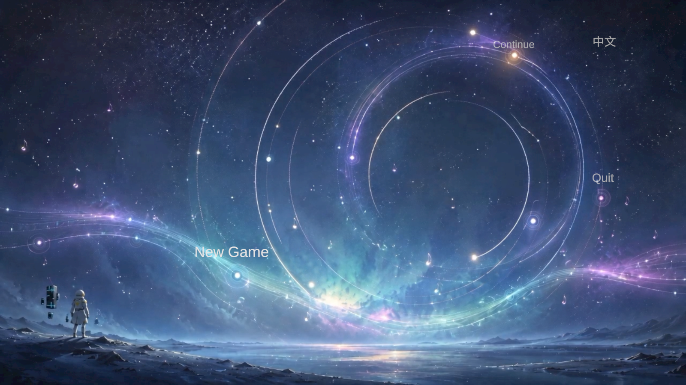
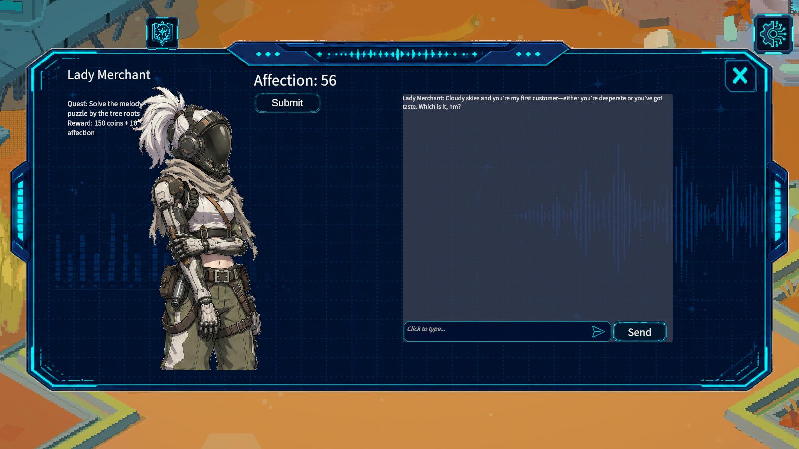
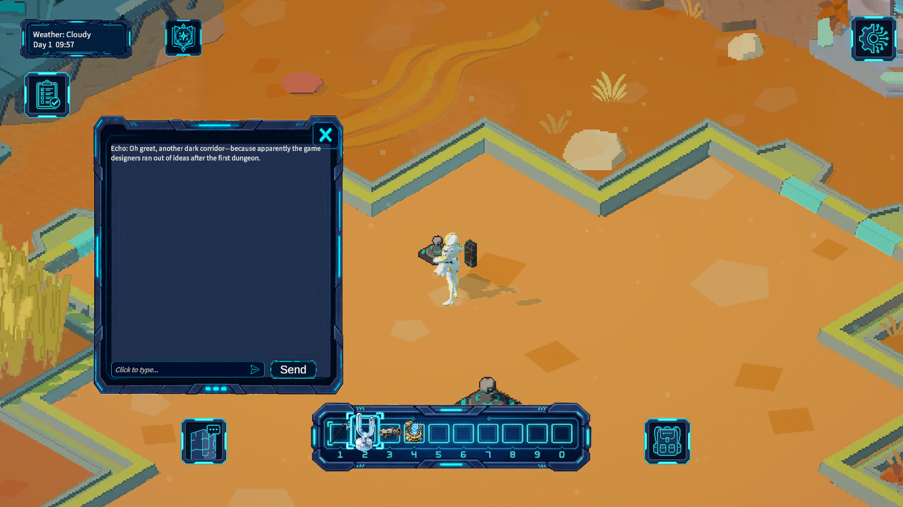
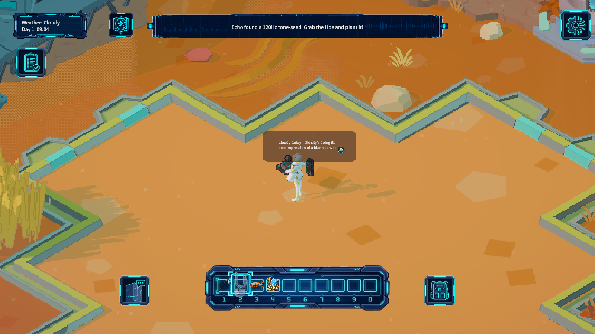
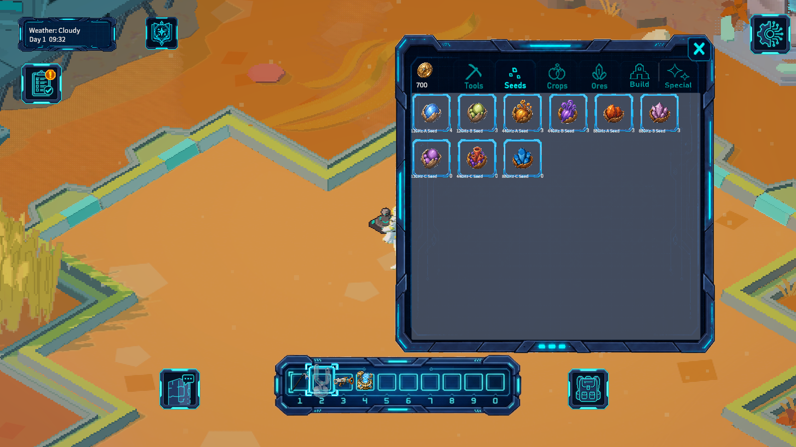
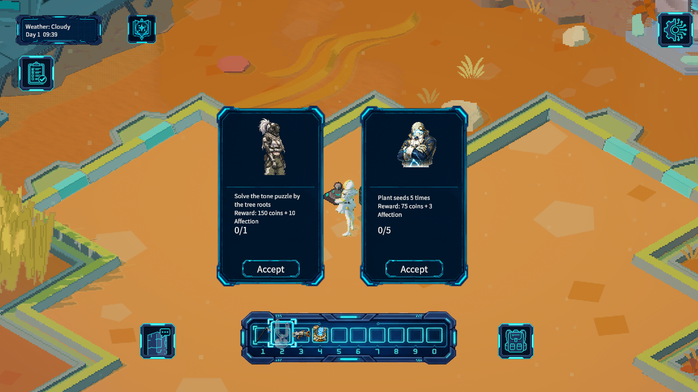
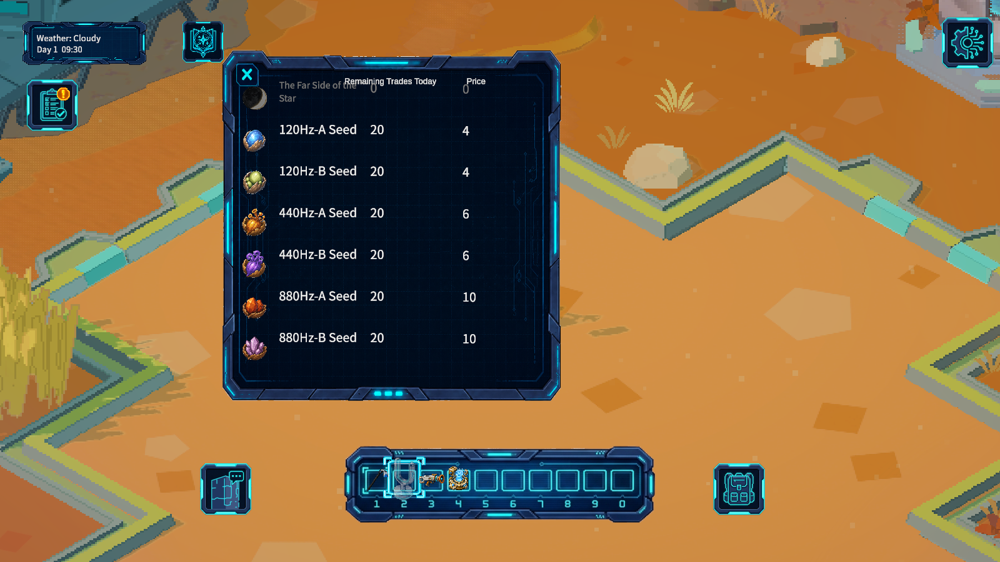
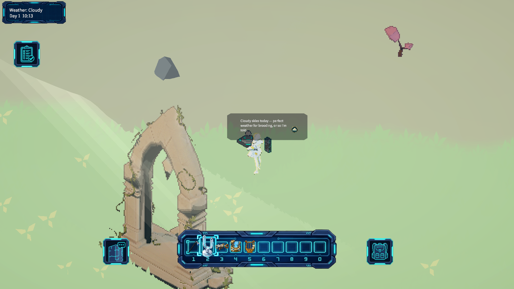
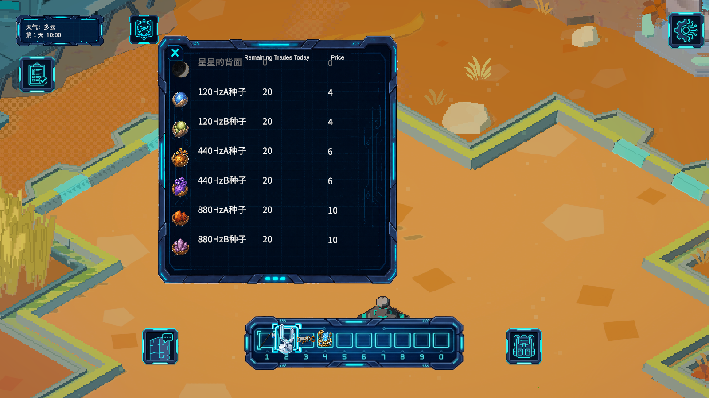

# Helios（赫利俄斯）

**A music-driven farming and exploration game where crops grow to melodies — and the people you meet are powered by a large language model.**

You land on Helios, a planet whose seeds respond to sound. Tune the right melody and they crystallize fast; play the wrong one and they mutate. Trade with merchants who actually talk back, solve musical puzzles in the forest, and keep your sarcastic robot companion Echo entertained.

## Play

| | |
|---|---|
| **Windows** | Download `Helios-Windows.zip` from [Releases](../../releases/latest), unzip, run `Helios.exe`. Windows 10/11, 64-bit. The build is unsigned, so SmartScreen may ask: *More info → Run anyway*. |
| **Browser** | [Play in the browser](https://y70647361-hub.github.io/StarResonance-Demo/) — desktop Chrome, Edge or Firefox. The first load downloads about 420 MB (cached afterwards). A few visual effects are simplified compared with the Windows build. |

- **Language:** English by default. Switch with the `中文 / English` button on the main menu, or *Settings → Language*.
- **AI features need an internet connection.** Offline, characters answer with short fallback lines and the rest of the game works normally.
- A first session following the tutorial takes about 15–20 minutes.

### Controls

| Key | Action |
|---|---|
| `W A S D` | Move (`Shift` to sprint) |
| Mouse left | Use the equipped tool / interact (click merchants, plots, machines) |
| `1` `2` `3` `4` `5` | Hoe · Tuning Fork · Resonance Gun · Builder · Harp |
| `Z X C V B N M` | Harp notes Do Re Mi Fa Sol La Si |
| `E` | Interact |

### Suggested path

1. Follow the tutorial: till a plot, plant the 120Hz seed, place a Tuning Fork next to it and play a melody. The right melody speeds growth; a different one makes the crop mutate.
2. Talk to the **Lady Merchant**. Type anything — she is an LLM-driven character with a persona. Try complimenting her: if she is convinced, the shop gets cheaper.
3. Fuse two seeds in the Fusion Chamber, sell the crystal, then follow the Drum Mole into the mining area.
4. Open the chat button (bottom left) to talk to **Echo**, the robot. Echo also comments on the weather and on things that happened to you.

| | |
|---|---|
|  |  |
|  |  |
|  |  |
|  |  |

## AI in the game

This demo explores LLM-driven characters inside an ordinary game loop, rather than as a separate chatbot.

- **Characters with state, not just a persona.** Each merchant's system prompt combines a hand-written persona with live game state: the relationship tier derived from the affection value, today's weather, and whether the player has run into a random event. The same question gets a colder or warmer answer depending on how the relationship has developed.
- **Turning free-form talk into a game mechanic.** The prompt defines a hidden protocol: if the model judges the player's message to be sincere flattery, it appends a `[DISCOUNT]` marker. The game strips the marker from the displayed text and lowers that merchant's prices until the next conversation. The player never sees a menu option — persuasion happens in natural language, and the model is the judge.
- **Authored story beats inside generated dialogue.** Scripted lines (quest introductions, the affection-100 gift scene) are written by the designers and injected into the conversation history as assistant turns, so the model continues *from* the story instead of contradicting it.
- **A proactive companion.** Echo speaks without being asked: a daily weather report and random remarks every 30 seconds to 3 minutes, grounded in the planet's lore and in the events the player has actually experienced.
- **Generated ambient content.** Placed "SpongeBob" decorations get a batch of distinct one-liners from a single request, split across all objects in the scene.
- **Language-aware prompting.** The whole prompt (persona, rules and context) switches with the game language, which keeps the model's output language stable.
- **Engineering around the model.** The API key never ships with the game: requests go through a serverless proxy. Late replies from a closed conversation are discarded by session ID, and network failures fall back to in-character lines so the game never stalls on the model.
- **AI-assisted content pipeline.** Several 3D models (the cookie-hat character, the enchanted portal, the green robot, the leafy elf) were generated with Tripo AI and brought in through its Unity bridge.

## Technical notes

- Unity 6 (6000.4), Universal Render Pipeline, C#. LLM: DeepSeek, called through a Tencent Cloud Function (Express).
- **Localization.** A bilingual zh/en layer: strings in code are written as `Loc.T("中文", "English")` side by side; text authored in the Inspector is translated through a source-keyed table (the gettext idea: the original text is the key). Editor tooling extracts every serialized Chinese string, attaches runtime switchers to static labels, swaps sprites that have text baked in, and reports anything left untranslated.
- **Automated testing.** A play-mode smoke test runs headless in batch mode (38 checks: new-game flow, every UI panel, save/reload round trips, farm persistence, language switching). A separate screenshot-tour build plays through the main screens in both languages for visual review.
- **Persistence.** JSON saves cover inventory, merchants and quests, world puzzles, farm plots with growing crops, and placed tuning forks, and survive the portal trips between regions.

## Known limitations

- The Ruins portal, unlocked late in the game, leads to a placeholder scene that has not been built yet.
- Codex illustrations are screenshots of the Chinese UI.
- The browser version uses lower texture resolution and leaves out a few effects that need GPU features WebGL 2 does not have (lantern glow, light shafts and cloud shadows in the forest, the desaturation inside silence zones). Mobile browsers are not supported.

## About this repository

This repository hosts the playable builds and documentation only: `docs/` is the browser build served by GitHub Pages, and the Windows build is attached to the [Releases](../../releases/latest). The source project is kept private because it contains licensed Unity Asset Store content.

Third-party assets include COZY: Stylized Weather 3 (Distant Lands), TileWorldCreator (Giant Grey), ProPixelizer, Stylized Water 3 (Staggart Creations), Critter Volumetric Lighting, and POLYGON Adventure (Synty Studios), used under their respective licenses.

---

### 中文简介

《赫利俄斯》是一款以音乐为核心的种田探索游戏：种子会回应旋律，弹对音乐加速生长，弹错就会变异。商人和随行机器人"回声"由大语言模型驱动，会结合好感度、天气和玩家经历过的事件对话；对商人真诚地夸奖可能换来折扣。游戏默认英文，可在主菜单右上角或设置中切换为中文。
